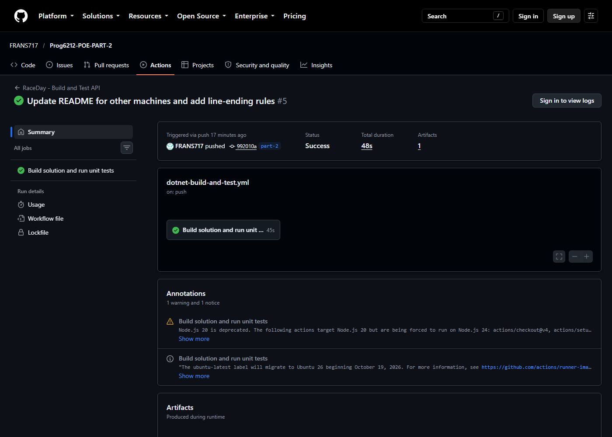

# RaceDay - PROG6212 POE

[](https://github.com/FRANS717/Prog6212-POE-PART-2/actions/workflows/dotnet-build-and-test.yml)

RaceDay is an event management platform for South African road running, walking and cycling events. Organisers create events, categories and results. Participants browse events, enrol by category and track their results.

This branch (`part-2`) is the **RESTful API**. The Part 1 planning documents are in `docs/`. Part 3 (MVC front end, Azure Blob Storage, Docker) comes later.

| Part | Status | Where |
|------|--------|-------|
| Part 1 - Planning (ERD, endpoint plan, SQL script) | Done | `docs/` |
| Part 2 - RESTful API (EF Core, sessions, Swagger, unit tests, CI) | Done on `part-2` | `src/RaceDay.Api`, `tests/RaceDay.Api.Tests` |
| Part 3 - MVC front end, Azure Blob Storage, Docker | Not started | - |

## The Two Roles
- **Organiser:** creates, edits and deletes their own events; manages their categories; views every enrolment for their events; sets enrolment status; captures and corrects finish times and positions. Registers with an organisation name and contact number.
- **Participant:** registers with a date of birth; browses events; enrols in an event by choosing a category; views their own enrolments and race history; updates their profile and picture.

Anyone can browse events and categories without logging in. Other endpoints return **401** without a session and **403** when the wrong role calls them.

## Prerequisites
- **.NET 10 SDK** (`dotnet --version` should report 10.x)
- **SQL Server.** The default connection is SQL Server LocalDB, which comes with Visual Studio. On another machine, point the app at any SQL Server (see below).
- **Visual Studio 2022 or 2026** (optional). Open `RaceDay.slnx`, set `RaceDay.Api` as the startup project, and press F5.

## Setup and Run
```bash
git clone https://github.com/FRANS717/Prog6212-POE-PART-2.git
cd Prog6212-POE-PART-2
git checkout part-2
dotnet run --project src/RaceDay.Api
```

Swagger UI opens at **http://localhost:5043/swagger**. The first run creates `RaceDayDB`, applies the EF Core migrations and adds the sample data.

Log in with `POST /api/auth/login` first. Swagger keeps the session cookie, so the protected endpoints work straight away.

### Using another machine or SQL Server
The connection string is `ConnectionStrings:RaceDayDb` in `src/RaceDay.Api/appsettings.json`. Any value there can be overridden with an environment variable, so you don't need to edit the file.

PowerShell:
```powershell
$env:ConnectionStrings__RaceDayDb = "Server=localhost\SQLEXPRESS;Database=RaceDayDB;Trusted_Connection=True;TrustServerCertificate=True;"
dotnet run --project src/RaceDay.Api
```

Bash:
```bash
export ConnectionStrings__RaceDayDb="Server=localhost,1433;Database=RaceDayDB;User Id=sa;Password=...;TrustServerCertificate=True;"
dotnet run --project src/RaceDay.Api
```

Other things to know on a new machine:
- **Port in use:** change the port with `--urls http://localhost:5050`. Swagger then moves to that port.
- **HTTPS profile:** `dotnet run --launch-profile https` needs a trusted dev certificate. Run `dotnet dev-certs https --trust` once.
- **Using the Part 1 SQL script instead:** running `docs/RaceDay-Schema.sql` in SSMS creates the same database. Don't also run the API against it, because the migrations would try to create tables that already exist. Drop the database first or use a new server.

## Seeded Accounts
The sample data matches the Part 1 SQL script. Every seeded account uses the password **`Password123!`**.

| Email | Role |
|-------|------|
| organiser1@raceday.com | Organiser (Cape Town Events) |
| organiser2@raceday.com | Organiser (Durban Sports) |
| participant1@raceday.com | Participant |
| participant2@raceday.com | Participant |
| participant3@raceday.com | Participant |

## Running the Unit Tests
```bash
dotnet test RaceDay.slnx
```
The tests run the real API against an in-memory database, so they need no SQL Server. They cover registration and login for both roles, sessions, password hashing, event management and ownership, role enforcement (401 and 403), enrolments, results, categories and the Swagger document.

## Endpoints
Full details are in `docs/endpoint-plan.pdf` and in Swagger UI.

| Method | Route | Role | Purpose |
|--------|-------|------|---------|
| POST | /api/auth/register | Public | Register an Organiser or Participant |
| POST | /api/auth/login | Public | Log in and start a session |
| POST | /api/auth/logout | Logged in | End the session |
| GET | /api/users/profile | Logged in | Get own profile |
| PUT | /api/users/profile | Logged in | Update own profile |
| POST | /api/users/profile/picture | Participant | Upload profile picture |
| GET | /api/events | Public | List events (filters: type, date, location, mine) |
| GET | /api/events/{id} | Public | Event details with categories |
| POST | /api/events | Organiser | Create event |
| PUT | /api/events/{id} | Organiser (owner) | Update event |
| DELETE | /api/events/{id} | Organiser (owner) | Delete event |
| POST | /api/events/{eventId}/upload-banner | Organiser (owner) | Upload banner image |
| GET | /api/events/{eventId}/categories | Public | List categories |
| POST | /api/events/{eventId}/categories | Organiser (owner) | Add category |
| PUT | /api/categories/{id} | Organiser (owner) | Update category |
| DELETE | /api/categories/{id} | Organiser (owner) | Delete category |
| GET | /api/enrolments | Logged in | Organiser: enrolments for their events. Participant: own enrolments |
| GET | /api/events/{eventId}/enrolments | Organiser (owner) | Enrolments for one event |
| POST | /api/events/{eventId}/enrol | Participant | Enrol in an event by category |
| PUT | /api/enrolments/{id}/status | Organiser (owner) | Set Pending, Confirmed or Cancelled |
| GET | /api/results/me | Participant | Own race history |
| GET | /api/events/{eventId}/results | Organiser (owner) | Results for one event |
| POST | /api/events/{eventId}/results | Organiser (owner) | Capture a finish time and position |
| PUT | /api/results/{id} | Organiser (owner) | Correct a result |

## Deviations from the Part 1 Plan
The API follows the approved plan. These differences were added or needed:

1. **`contactNumber`** is sent on Organiser register and profile update. The Organisers table requires it, and the plan's body didn't include it.
2. **`POST /api/users/profile/picture`** was added for the profile picture that Part 3 needs.
3. **`GET /api/events?mine=true`** was added so the Organiser dashboard can list only that Organiser's events.
4. **`PUT /api/users/profile`** returns **409** if the new email belongs to another account. The plan listed only 200 and 400.
5. **`DELETE /api/events/{id}`** also removes the event's categories, enrolments and results, in one transaction. Foreign keys would otherwise block the delete.
6. **`DELETE /api/categories/{id}`** returns **409** if participants are enrolled in it, so their enrolments aren't lost.
7. **Enrolment age check:** `POST /api/events/{eventId}/enrol` returns 400 when the participant's age on the event date is outside the category's range.
8. **Results** include `totalFinishers`, so the Participant view can show "47th out of 312".
9. **Errors** always return `{ "message": "..." }`.

## Design Notes
- **Schema:** `RaceDayDbContext` maps the tables, keys, unique indexes, check constraints, defaults and delete rules from the Part 1 SQL script. The initial migration in `Data/Migrations/` creates the same tables.
- **Sessions:** login stores the user ID and role on the server. `[RequireSession]` returns 401 with no session and 403 for the wrong role. Ownership checks return 403.
- **Passwords:** stored only as BCrypt hashes.
- **Files:** uploads go through `IFileStorage`. Part 2 saves them under `wwwroot/uploads` (git-ignored). Part 3 adds an Azure Blob implementation without changing the controllers.

## CI/CD
- `.github/workflows/dotnet-build-and-test.yml` builds the solution and runs the unit tests on every push and pull request.
- `.github/workflows/validate.yml` checks that the Part 1 planning documents are in `docs/`.

**Green build:** the successful run on `part-2` is shown below, and the run itself is at https://github.com/FRANS717/Prog6212-POE-PART-2/actions/runs/38826787930



## Video Presentation
- **Part 1 (planning):** https://youtu.be/RrkhZZGbrcM
- **Part 2 (API, authentication, Swagger, unit tests):** *(add the unlisted YouTube link before submitting)*

## AI Use Disclosure
AI tools (Claude) helped plan the structure, write parts of the code and tests, and draft this README. Every change was reviewed and run locally. The design choices are explained in the video.

## Student Declaration
I declare that this work is my own original work and all sources have been properly referenced.
Name: Brain Frans Mashabela
Student Number: ST10476451
Date: 02/09/2026
